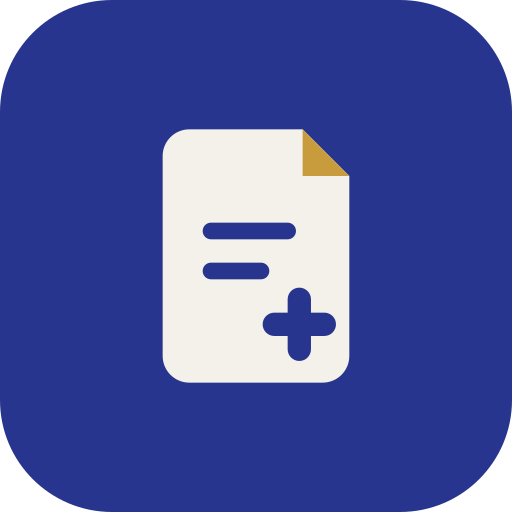
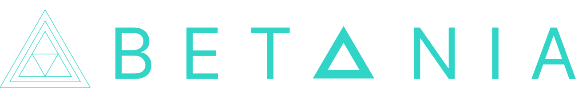

# Образац+ – лична карта у читач, попуњен документ на штампач

Десктоп програм за адвокате, адвокатске приправнике и јавне бележнике: убаци се лична карта у читач, програм прочита
податке са чипа, изабере се шаблон (пуномоћје, изјава, сагласност, уговор…), допишу се подаци којих нема на картици, и
документ се одштампа или сачува као PDF и Word. Ради без интернета и без Office-а; документ је увек ћирилицом.

## Преузимање – верзија 1.1.0

| Систем | Пакет |
|---|---|
| Windows 10/11 | [ObrazacPlus-setup.exe](https://github.com/betania-tech/obrazacplus/releases/latest/download/ObrazacPlus-setup.exe) |
| macOS | [ObrazacPlus.pkg](https://github.com/betania-tech/obrazacplus/releases/latest/download/ObrazacPlus.pkg) |
| Linux (Ubuntu/Debian) | [obrazacplus_amd64.deb](https://github.com/betania-tech/obrazacplus/releases/latest/download/obrazacplus_amd64.deb) |

Сва издања: [Releases](https://github.com/betania-tech/obrazacplus/releases). Страница за преузимање:
https://betania-tech.github.io/obrazacplus/ · https://betania.io/apps/obrazacplus

Програм сам јавља кад изађе нова верзија; инсталира се преко постојеће, подешавања остају.

**Инсталатери још нису дигитално потписани**, па систем при првом покретању упозорава:

- **Windows** – „Windows protected your PC“ → *More info* → *Run anyway*.
- **macOS** – десни клик на `ObrazacPlus.pkg` → *Open* (или *System Settings → Privacy & Security → Open Anyway*).
- **Linux** – `sudo apt install ./obrazacplus_amd64.deb` (сам повлачи `pcscd` за читач и CUPS за штампу).

## Шаблони, AI и подршка

- 18 уграђених шаблона: пуномоћја, овлашћења и потврде, изјаве, сагласности, уговори и извод са личне карте.
- Треба вам документ којег нема? У програму **✉ Затражи шаблон** – Betania га прави, а стиже у следећем ажурирању.
- **„Питај AI“** на почетној нађе шаблон по опису кад обична претрага не нађе; **„Среди правнички“** и **„Исправи
  грешке“** помажу код слободног текста (уз лиценцни кључ и интернет).
- Дугме **Подршка** у програму: захтев за шаблон, питање, пријава грешке, лиценца и куповина – одговор стиже на
  е-пошту коју упишете (ради и у пробној верзији).

## Цене и претплата

Пакети по броју корисника (рачунара): **Соло** 1.290 дин месечно по кориснику, **Канцеларија** 3.490 дин (5 корисника,
сваки следећи 690), **Велика канцеларија** 7.990 дин (15 корисника, сваки следећи 490); годишње плаћање = 10 месеци.
Калкулатор и шта који пакет садржи: **https://betania-tech.github.io/obrazacplus/cene.html**

Цене су без ПДВ-а – **Betania Tech тренутно није у систему ПДВ-а**, па се ПДВ не обрачунава.

Претплатни кључ се уноси једном (Подешавања → Лиценца); претплата се продужава уплатом по предрачуну, без новог кључа.
Програм проверава претплату при покретању и на неколико сати и ради без интернета до 14 дана од последње провере. Кад су
сва места заузета, администратор канцеларије у програму види списак рачунара и ослобађа стари. После истека програм ради
још 7 дана уз упозорење, а затим се закључавају штампа и чување (преглед остаје) док уплата не легне.

## Пробна верзија и лиценца

Без кључа програм ради као пробна верзија: 14 дана од првог покретања и највише 30 штампи или чувања; преглед, демо
лице и симулација штампе раде и после тога. Кључ са датумом важења (издат пре претплате) ради као и до сада, без
интернета, до датума уписаног у њему. Канцеларија добија кључ организације: администраторски и кориснички за цело особље.

## Заштита података

Ништа од личних података странака се не чува – ни дневник ни картотека. Преглед рада канцеларије (уз кључ
организације) нема ниједан податак о физичком лицу. AI помоћник шаље само текст поља или упит претраге, а имена и
ЈМБГ пре слања замењује ознакама.

---

Софтвер је израдила **Betania** (https://betania.io). Питања, лиценце и захтеви за шаблоне: дугме **Подршка** у програму или **hello@betania.io**.
